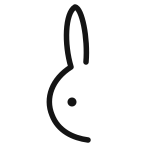
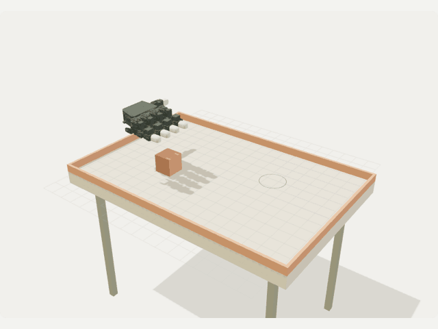
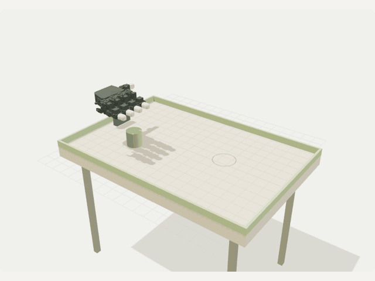
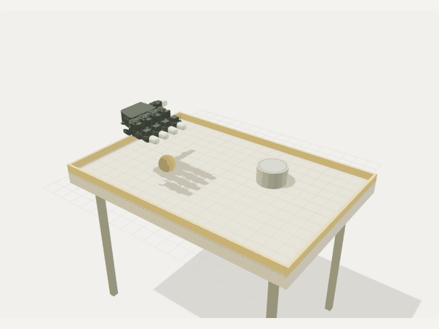
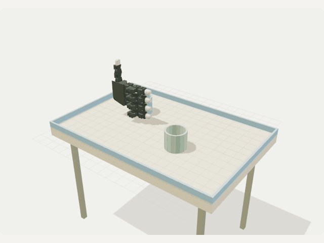

<p align="center">
  
</p>

<h1 align="center">Labbit</h1>

<p align="center"><em>A simulation-first lab for robot decisions.</em></p>

<p align="center">
  <a href="https://hand-studio.hidden-pond-5e6a.workers.dev">Try the live lab</a> ·
  <a href="https://huggingface.co/datasets/MedSalim/labbit-robotic-manipulation">Explore the generated dataset</a>
</p>

**Labbit** is a play on *lab* and *rabbit*: a minimal live robotic-hand workbench and a reproducible simulation dataset factory. The goal is **100,000 useful, diverse 20-second episodes**.

**Live deployment:** https://hand-studio.hidden-pond-5e6a.workers.dev

**Hugging Face dataset:** https://huggingface.co/datasets/MedSalim/labbit-robotic-manipulation

### See the recorded data

| Pick & place · episode 1 | Contact push · episode 2 |
| --- | --- |
|  |  |
| Stack · episode 4 | Particle pour · episode 3 |
|  |  |

These GIFs render actual published frames, sampled at 10 Hz for documentation; the dataset retains all 361 frames at 30 Hz. Pick/place, stacking and cup handling use assisted grasps. Pouring uses 36 rigid particles, not continuum water. The shown pushing episode finishes **24.7 cm from its target**—a retained failure, not a success claim. Exact episode hashes, dataset revision and frame indices are in [`docs/media/previews.json`](docs/media/previews.json).

### Objective and usefulness

Labbit makes simulated manipulation **inspectable and reproducible**: connect physical parameter proposals to recorded motion, measured outcomes and separately attributed visual reviews. Change shape, mass, friction, placement or motion parameters without confusing a proposal with a successful demonstration.

- **Motion and perception research:** render known 3D trajectories into images and study temporal representation, object-motion prediction or scene tracking.
- **Simulation/debugging:** replay exact hand/object transforms, inspect grasp alignment, and compare numerical outcomes across scenario families.
- **Dataset tooling:** exercise provenance, integrity checks, compact storage, parallel processing and failure-aware review pipelines before scaling.

This is **not** a validated sim-to-real benchmark or a complete low-level policy-training dataset. Tabletop exports contain transforms/contact counts/grip telemetry, not per-frame actuator commands or full joint-state/force telemetry. Assisted grasps and disabled hand collisions limit contact-policy conclusions. See the [dataset card](docs/dataset-card.md) for scope, units, formats and responsible use.

### Release status

PRs #1 and #2 were merged on November 7, 2026. This follow-up adds compact published replay and visual dataset documentation. Paid Muse/SubQ requests still require an explicit review count and spending cap; browsing or rendering does not trigger them. The coordinator's reservation is a conservative local cap, not actual provider billing.

### Minimal simulation views

**Single** keeps orbit, playback, scrubbing and export controls. **Grid** replaces the old Hand studies tab with 4, 9, 16 or 25 tabletop simulations at once, task filtering and paging through the collection. Click a tile's number to focus it. The grid uses one shared WebGL canvas, one sequential physics worker and packed 10 Hz transforms (full single-episode exports remain 30 Hz). The 25-view cap bounds memory/GPU usage; it does not load all 1,000 scenarios at once. Legacy hand replay remains available in **Data & AI → Legacy recordings** or `/#hands`.

Task, view-count and speed controls use consistent styled dropdowns with arrow-key navigation, Home/End, Enter, Escape and visible focus states.

Main-screen introductions, readiness labels, study descriptions, provenance and inspector paragraphs are removed. Model limitations, measured outcomes, selected-plan attribution and the published Hugging Face inventory remain in the data panel. The tabletop paid-generation button stays unavailable until a campaign is authorized.

### Compact published replay

The default tabletop workspace first looks for an exact matching published recording, then computes unrecorded scenarios on demand. Published data is pinned to a Hugging Face commit and validated against scenario identity, SHA-256, geometry and telemetry. Failed/corrupt published downloads show an error with Retry; they are not silently replaced by newly computed data. Data & AI identifies the playback source and immutable dataset revision. This works in Single and Grid without initializing MuJoCo for recorded episodes.

The app serves those pinned public files through a read-only same-origin endpoint to avoid Hugging Face resolver CORS failures. Only allowlisted files/revisions can be requested; bytes are checked before immutable caching. Vite forwards this specific read route to the deployed endpoint while keeping native APIs local.

Standalone exports remain compatible. Compact episode copies preserve every recorded number and all 361 frames at 30 Hz; mesh geometry is stored once by content hash. Copies do not inflate recorded counts. Four conversion workers own distinct episode outputs, share only immutable mesh objects, and a single parent validates/consolidates the manifest.

The existing 100-episode pilot uses **132.7 MB** in compact form versus **1,077.1 MB** standalone (about **88% smaller**), with 10 shared meshes. Original files are retained on Hugging Face, so this additive compatibility release does not shrink the total repository storage footprint.

```sh
# Local conversion of the existing pilot; no physics regeneration or AI calls.
python -m scripts.compact_tabletop --workers=4

# Add compact files without deleting or re-uploading standalone trajectories.
hf upload MedSalim/labbit-robotic-manipulation data/publish . --repo-type dataset \
  --include "tabletop/compact/*" "tabletop/meshes/*" "README.md" "catalog.json"

# After upload, pin the frontend to the uploaded dataset commit (40-character SHA).
python -m scripts.compact_tabletop --pin <HF_COMMIT_SHA>
npm run test:recordings
```

`--source` and `--output` select separate conversion directories. The pin step checks the uploaded manifest matches the validated local inventory before updating `config/tabletop-recordings.json`; cloud preparation copies that small snapshot, not the raw dataset, into frontend assets. Paid Muse/SubQ work still requires a separate review count and spending cap.

### Dataset attribution

Open **Data & AI** in either workspace to distinguish **MuJoCo trajectories**, **Muse parameter proposals/rationale**, and **SubQ visual reviews**. The panel includes a Hugging Face button, collection files, model/plan attribution and raw saved review outputs. Unreviewed tabletop episodes are labeled **SubQ not reviewed**; existing hand-only reviews are not fabricated into tabletop labels.

The current expanded collection contains **1,000 planned Muse-derived scenarios** from a real accepted 24-anchor Muse Wonder plan. **100 of those tabletop trajectories** are exported alongside **390 archived hand-only episodes**. Planned, recorded and reviewed counts are separate. Raw trajectories live on Hugging Face; small public inventory/plan snapshots are versioned in `config/` and copied into the frontend at startup/build.

The corrected tabletop grip uses MuJoCo fingertip kinematics, a palm-facing wrist frame and an object-local offset. Cups use a side grip that rotates with the cup. Grasps are still assisted by a compliant weld—not an autonomous contact-grasp policy. Pour geometry and fluid clearance remain calibrated; shape/size/mass proposals describe solid objects, while pouring varies placement, speed and surface friction.

The previous 100 seeded baseline scenarios remain the fallback when no Muse plan is available. The larger collection varies supported tasks, shapes, sizes, masses, friction, source/target placement, transport curvature, lift and speed within validated bounds.

### Reproduce exports and publish with the CLI

```sh
# Explicit paid call; only run after agreeing on a campaign and spending cap.
node scripts/generate_muse.mjs

# Local physics only: validate and export 100 scenarios from the saved plan.
node scripts/check_tabletop.mjs --plan=data/publish/muse/tabletop-plan.json --export
python -m scripts.prepare_data

# Authenticate locally. Never paste tokens into source or dataset files.
hf auth login
hf upload MedSalim/labbit-robotic-manipulation data/publish . --repo-type dataset
```

See [`docs/dataset-card.md`](docs/dataset-card.md) for formats, provenance, privacy and modeling limitations. `catalog.json` on Hugging Face is the published inventory; a new plan does not silently add completed recordings or SubQ labels.

Task-filtered exports (`--tasks=pour`) must match the existing scenario fingerprint before any trajectory writes. For a different plan, use a new directory with `--output=data/another-export`. Publication verifies unique study IDs/filenames and trajectory↔index↔scenario agreement before changing publication files. `node scripts/check_tabletop_export.mjs` and `tests/test_tabletop_publication.py` cover these guards.

### Tabletop workspace (new default)

The baseline contains **100 deterministic tabletop studies**: 25 pick/place, 25 surface pushes, 25 stack/balance tasks, and 25 cup-to-cup particle pours. The default loads the published **1,000-scenario Muse plan**, with the baseline as a fallback. Matching published recordings replay directly; other studies compute a 12-second MuJoCo trajectory (361 frames including the initial state). The scenario count is **not a count of stored recordings**. Six recent full episodes are cached to bound browser memory.

- Browse or search the sidebar; filter by task. On mobile, use **Browse**.
- Use **← / →** for previous/next, **Space** to pause, the timeline to scrub, and the speed selector for slow motion. Drag to orbit and scroll/pinch to zoom.
- Export a selected episode as JSON with transforms, contact counts, task parameters, measured target error / retained particles, and explicit provenance.
- The tabletop hand is a **custom five-finger, 20-actuator extension** of the licensed LEAP geometry, with a duplicated articulated little finger. It is not a calibrated five-finger hardware model. The original four-finger / 16-DOF dataset remains unchanged under **Legacy recordings** (`/#hands`).
- Pick/place, stacking, and cup handling use a scripted mocap wrist and temporary weld-assisted grasp. Objects have mass, gravity, friction and physical contacts, and become unconstrained on release. Surface pushing uses a collision-driven pusher. These are **assisted manipulation demonstrations, not autonomous learned grasp policies**; visual hand collisions are disabled in this version.
- “Water” is **36 discrete rigid particles** interacting with compound cup walls, not a continuum fluid solver. The data panel reports particles retained in the receiving cup; it does not claim calibrated fluid volume or real-world pouring success.
- The rabbit icon is an SVG recreation of the supplied brand reference. Text uses a larger system font without external font downloads.

Run `npm run test:tabletop` to validate the 100 baseline scenarios; `npm run test:cloud` checks cancellation, immutable-shard validation, crash recovery, stale-status consistency and remote cancellation without cloud writes or AI calls. `npm run test:first-launch` checks a real Chrome startup without a previous cloud build, and `node scripts/check_tabletop_retry.mjs` checks successful recovery after an exhausted asset download.

### Active Python environment (POSIX and Windows)

The npm cloud-build and Playwright commands use the activated environment's `python`, not a hard-coded POSIX virtualenv path. Activate before running them:

```sh
# macOS / Linux
python3 -m venv .venv
source .venv/bin/activate
python -m pip install -r requirements.txt
npm run build:cloud
```

```powershell
# Windows PowerShell
py -m venv .venv
.\.venv\Scripts\Activate.ps1
python -m pip install -r requirements.txt
npm run build:cloud
```

### Try it

1. Open the live lab. The 4/9-view hand simulation needs no login; double-click a hand to focus, pause or reseed it.
2. Open the dataset panel and replay the saved production episodes, or download their manifest and shards.
3. To generate/save a new dataset or call Meta/SubQ, use the key icon and enter `ADMIN_TOKEN` from your local, gitignored `.deploy.env`.
4. Choose 100 episodes, optionally request a Meta variation plan, then generate. **Keep the tab open**: deployed physics runs in browser WASM, not in an unattended cloud compute service.

The Cloudflare Worker URL and R2 bucket retain their original `hand-studio` infrastructure names to preserve existing secrets, object keys and live links. The product is now Labbit; rebranding does not migrate or delete datasets.

## Data generated so far

**Archived hand-only inventory, 7 November 2026.** The table below covers the older hand-motion pilots only; the published tabletop collection and in-progress campaign are described above. These are completed pilot runs, not a completed 100k dataset. Tests, temporary fixtures and local Wrangler smoke runs are excluded.

| Run | Location | Episodes | Duration | Frames | Shards | Compressed size |
|---|---|---:|---:|---:|---:|---:|
| [Production pilot](https://hand-studio.hidden-pond-5e6a.workers.dev/datasets/7c850e6a-ff7f-4a42-9c12-375c2e28549b/manifest.json) | Cloudflare R2 | 100 | 20s | 60,000 | 10 JSON/gzip | 23.55 MB |
| `objectives100-20s` | Local native MuJoCo | 100 | 20s | 60,000 | 4 Parquet/zstd | 15.37 MB |
| `objectives100` | Local legacy pilot | 100 | 5s | 15,000 | 4 Parquet/zstd | 4.50 MB |
| `pilot90` | Local legacy pilot | 90 | 5s | 13,500 | 1 Parquet/zstd | 4.18 MB |

**Total: 390 episodes / 148,500 frames**, of which **100 episodes / 60,000 frames are deployed in R2**. All passed their numerical validity checks. Both 20s pilots also passed the tracking-based objective proxy; this is not proof of object grasping or real-world safety. The production pilot used **28 Muse Wonder parameter variants** and met all 14 objective quotas. Generation, persistence and R2 replay were tested end to end; the ~134s cloud smoke-test duration includes downloads, planning and uploads.

Production run ID: `7c850e6a-ff7f-4a42-9c12-375c2e28549b`. Its manifest contains each shard's filename, episode range, size and SHA-256 checksum. Download a shard by joining its filename to:

```text
https://hand-studio.hidden-pond-5e6a.workers.dev/datasets/7c850e6a-ff7f-4a42-9c12-375c2e28549b/
```

Local runs are in `data/runs/` on the development machine, **not committed to Git and not automatically uploaded to R2**. Browser/native engines and controller revisions differ; inspect each manifest's provenance before pooling datasets. The archived production pilot predates the current browser anchor-jitter controller revision and remains available for replay.

### Read a production shard

```python
import gzip
import json
from urllib.request import urlopen

base = "https://hand-studio.hidden-pond-5e6a.workers.dev/datasets/7c850e6a-ff7f-4a42-9c12-375c2e28549b/"
with urlopen(base + "manifest.json") as response:
    manifest = json.load(response)
with urlopen(base + manifest["shards"][0]["file"]) as response:
    episodes = json.loads(gzip.decompress(response.read()))
print(len(episodes), len(episodes[0]["qpos"]))  # 10 episodes, 600 frames each
```

Provider keys, admin tokens, private `.env` files, dependency folders, generated model binaries and trajectory files are excluded from the source commit. The pinned robot source metadata and original license are retained.

## What we are building

```text
Objective + coverage quota
        ↓
Seeded bounded parameters ← optional Muse Wonder proposals
        ↓
MuJoCo physics (never an LLM pretending to be physics)
        ↓
Numerical checks + tracking scores
        ↓
Selective SubQ visual review / future Muse Spark audits
        ↓
Versioned trajectory shards + manifest → Cloudflare R2
        ↓
N live Three.js views + recorded-episode replay
```

**Implemented:** 14 movement objectives, weighted quotas, 20-second recording, reproducible seeds, actual joint states/commands/forces, bounded disturbance recovery, validation metrics, sharded persistence, cancel/resume, 4/9 live views, replay, explicit SubQ image+text evaluation, Cloudflare Worker/R2 integration, and an optional Muse Wonder parameter planner.

**Not implemented yet:** object grasping/lifting/rotation, tactile sensor models, learning policies, automatic large-scale VLM annotation, advanced semantic success tests, held-out difficulty splits, or an unattended cloud physics service. Pinch/tripod/roll currently describe **hand poses and trajectories**, not successful manipulation of an object. Meta proposals alter supported bounded parameters, not executable code or robot geometry.

## 1. Twenty-second episodes

- 20 seconds simulated time; **600 recorded frames at 30 Hz**.
- Physics timestep: 2 ms, approximately 10,000 integration steps per episode.
- Smooth startup over 0.6 seconds; tracking evaluation excludes the first second.
- Recovery episodes inject a 0.015 generalized-force pulse into one joint at 6s and 12s for 0.2s each. This is not a calibrated real-world disturbance.
- Record actual positions, velocities, actuator commands, actuator forces, applied generalized forces, timestamps and contact counts.
- 100k episodes means **60 million frames**, not 100k frames.

Native benchmark on the development machine (two workers): 100 × 20s episodes in **9.47 seconds**, 100 numerically valid, 100 passing the tracking proxy, ~15.4 MB of Parquet. Linear extrapolation is **~2.6 hours and ~15 GB** for 100k. Budget 3–4 hours and extra storage; sustained thermal load, objective mix and I/O may change throughput. Images and VLM calls are excluded. **Do not apply native throughput estimates to browser/WASM** without a separate benchmark. Cloud JSON/gzip storage has a different size from Parquet.

## 2. Objectives and coverage quotas

The executable specification is [`config/objectives.json`](config/objectives.json). Quotas sum to 100%. A 100-episode run uses the percentage as its count; a 100k run uses the count below. For other sizes, largest-remainder rounding guarantees the requested total. A seeded portable shuffle mixes the objectives throughout a run.

| Objective | Quota | Episodes / 100k | Intended behavior |
|---|---:|---:|---|
| Flex | 12% | 12,000 | Coordinated opening and closing |
| Point | 6% | 6,000 | Index isolation while other fingers move |
| Pinch | 8% | 8,000 | Index–thumb pinch-shaped coordination |
| Wave | 6% | 6,000 | Traveling phase-offset finger flexion |
| Tripod | 6% | 6,000 | Index/middle/thumb coordination |
| Spread | 6% | 6,000 | Finger abduction/adduction |
| Sequence | 6% | 6,000 | Successive finger activation |
| Opposition | 6% | 6,000 | Thumb opposition-shaped movement |
| Roll | 6% | 6,000 | Small coordinated cyclic curls |
| Hold | 10% | 10,000 | Reach and maintain a stable pose |
| Precision | 8% | 8,000 | Small-amplitude controlled motion |
| Reversal | 8% | 8,000 | Smooth repeated direction reversal |
| Independent | 6% | 6,000 | One-finger isolation |
| Recovery | 6% | 6,000 | Recover after bounded force pulses |

### Planned contact-manipulation curriculum

Once object models and task-success tests exist, create a **separate dataset version**, not misleading labels on the current hand-only data. A proposed allocation is: movement foundations 20%; sphere/cube/cylinder grasp-and-release 25%; precision/contact alignment 20%; in-hand translation/rotation 15%; slip/disturbance recovery 10%; controlled release/transfer 10%.

Expand along object size/shape, friction, mass, initial pose, approach direction, occlusion, actuator limits and sensor noise. Later add bimanual transfer and deformable-object handling. New geometry and dynamics require fresh validation before quota allocation.

## 3. Bounded, reproducible diversity

Current seeded sampling varies initial joint pose, speed, amplitude and phase. Native NumPy and browser Mulberry32 sampling are **different generators**; their trajectories are not expected to be bit-identical. The objective shuffle is portable and matches across runtimes.

Every manifest records robot repository revision, model hash, physics/runtime version, controller recipe version, sampling rate and objective quotas. Cloud manifests record browser-engine provenance; do not silently pool native and WASM runs as if they were the same backend.

Meta may propose speed `[0.3, 1.5]`, amplitude `[0.4, 1]`, phase `[0, 2π]`, and supported objective IDs. These are **anchors**: seeded jitter varies speed ±15%, amplitude ±10% and phase ±0.25 rad within bounds, rather than repeating a few fixed trajectories. The server validates plan bounds; MuJoCo controllers clamp targets to actuator limits. Actual sampled parameters are recorded. Plans are saved with provider/model/usage metadata. Applying an optional cloud plan is an explicit choice before starting a run; quota allocation remains deterministic. Browser controller versions are recorded, and resume rejects a changed controller/model/runtime.

Next: stratify nominal/precision/near-limit/disturbed difficulty bands, hash/deduplicate trajectories, and split by recipe lineage and held-out parameter bands. Seeds alone do not prevent near-duplicate train/test leakage. Keep versioned failure datasets rather than discarding all difficult examples. These richer splits and near-duplicate audits are roadmap work.

## 4. Validation, not wishful labels

Implemented deterministic measurements:

- Finite recorded states/commands/forces.
- MuJoCo warning counts.
- Joint-limit deviation (numerical tolerance < 0.1 rad; this is not a hardware safety bound).
- Global and post-settling tracking RMSE.
- Peak velocity and mean absolute acceleration.
- `valid`: finite, warning-free and within numerical tolerance.
- `objective_pass`: `valid` plus post-settling tracking RMSE ≤ 0.08 rad.

**`objective_pass` is presently a tracking proxy**, not a complete semantic test of pointing, finger ordering, grasp stability or real-world safety. Add per-objective evaluators before claiming task success: inactive-joint drift for isolation; phase/order correlation for sequences; settling/recovery windows for perturbations; object height/pose/contact/slip/drop metrics for future grasping.

R2 upload checks validate schema, frame counts, finite vectors, IDs and objective schedule. Uploaded physics scores are **client-computed**, not independently re-simulated by Cloudflare. Treat browser uploads as trusted-admin experiment data, not verified measurements from arbitrary public users.

Track attempted, numerically valid, tracking-proxy-passed and AI-annotated counts separately. A quota currently counts **attempts**, not guaranteed task successes. If we later target 100k accepted episodes, bound regeneration attempts and retain rejection reasons.

## 5. Meta + SubQ: where the $100 is useful

Verified official Meta docs: https://dev.meta.ai/docs/models and https://dev.meta.ai/docs/structured-output . API base `https://api.meta.ai/v1`; Bearer `MODEL_API_KEY`.

| Model | Role | Current integration |
|---|---|---|
| **Muse Wonder `muse-wonder-1.0`** | Premium objective/variation design and difficult failure analysis | Cloud parameter planner, schema-constrained JSON, bounded output and validated variants |
| **Muse Spark `muse-spark-1.3`** | Structured descriptions and larger-volume trajectory/image audits | Can replace Wonder for planning via `META_MODEL`; bulk audit pipeline is planned |
| **SubQ Snap `subq-snap-1.1`** | Frequent choice/score decisions using images plus telemetry | Explicit four-frame UI evaluation with cached responses |
| **SAM 3.1** | Future cross-checking of segmentation/occlusion labels | Planned; use simulator object-ID buffers as primary ground truth |
| **Muse Image 1.0** | Optional visual-domain background augmentation | Planned, separate from physical trajectory labels |

Muse Wonder Full is subscription-only in Muse Code, not a pay-as-you-go API model. Use Wonder for the premium API path. Contributor models use inputs/outputs for training; we do not enable them by default.

Proposed $100 allocation: **$30 Wonder**, **$50 Spark audits**, **$10 SAM experiments**, **$10 reserve**. This is a strategy, not automatic spending. Example costs at current published Standard rates, with 4k input and 600 billed output tokens: Wonder ≈ $0.028/call; Spark ≈ $0.00755/call. Reasoning tokens are billed output; multimodal context, retries and longer answers increase cost. Use actual `usage`, not these examples, for accounting.

The deployed coordinator enforces a persistent **$100 conservative reservation cap** across its AI requests: $0.10 per Meta plan and $0.01 per SubQ evaluation. Reservations are retained even for failed requests; this protects the budget conservatively but is **not the provider's billing balance**. Query `POST /api/budget` with admin authorization. Set provider-side account limits too. Meta planner input/output are bounded; no continuous unattended API spending or auto-generated executable controller code.

Selective annotation strategy: audit representative trajectories, rare parameter cells, failures and uncertain cases first. For a complete 20s episode, choose up to four phase-spaced frames with compact telemetry; the current live UI samples four frames over ~2s and therefore does not evaluate the full episode. Store AI labels/probabilities separately from deterministic metrics. A VLM label never overrides a failed physics check.

## 6. Storage and visualization

### Native mode

Python multiprocessing generates without graphics. Parquet/zstd shards contain trajectory arrays; manifests include checksums and coverage. Atomic shard + manifest commits are resume checkpoints. Re-running the same configuration validates committed checksums and resumes. Configuration/model/recipe changes intentionally reject resume. Old completed 5s datasets remain usable; do not overwrite them.

### Cloudflare mode

```text
Browser Web Worker A: live MuJoCo WASM → Three.js (one renderer, N viewports)
Browser Web Worker B: headless 20s episodes → gzip JSON shards (10 episodes)
                 ↓ authenticated upload
Cloudflare Worker → Durable Object coordinator → R2 shard + manifest
                 ↑ replay/download
```

Standard Cloudflare Workers do **not** execute this native Python/MuJoCo stack. The deployed page performs real physics in browser WASM. A second browser worker keeps bulk generation off the live simulation worker. R2 stores completed shards durably; uploads are bounded, checksummed and idempotent. A Durable Object serializes manifest commits and budget reservations across tabs. JSON/gzip is used for browser shards; native Parquet conversion can be added downstream.

**Keep the tab open.** Background-tab throttling, sleep or closure pauses generation; Workers/R2 are not an unattended physics service. Resume from the last uploaded shard. Closing a tab may lose its current uncommitted 10-episode batch. Runs with no recent checkpoint are shown as interrupted after two minutes. For sustained unattended 100k generation, attach dedicated native/GPU compute or separately provision Cloudflare Containers; that is not implemented here.

Public users can view local-in-browser simulation and read saved datasets. **R2 writes and AI requests require the admin token.** Use the key icon to enter it; it is kept only in session storage and sent as a Bearer token. Provider keys stay in Worker secrets. No arbitrary R2 key uploads or deletes are exposed. A small R2 catalog indexes up to 500 runs, and the viewer shows the latest 20. Progress responses omit the potentially large shard list; full manifests remain explicitly downloadable. Pagination beyond that catalog is roadmap work.

R2 keys:

```text
runs/<run-id>/manifest.json
runs/<run-id>/shard-000000.json.gz
plans/<plan-id>.json
annotations/<input-hash>.json
```

Store trajectories once and reconstruct geometry for replay. Do not save 60 million mesh-transform frames or images by default. Retain LEAP's original license when distributing its model. `scripts/prepare_cloud.py` publishes only licensed model assets, never `.env`, local datasets or admin credentials.

## Run locally

Python 3.12+ and Node 20+:

```sh
python3 -m venv .venv
source .venv/bin/activate
python -m pip install -r requirements.txt
python scripts/fetch_model.py
npm install
```

Copy `.env.example` to `.env`; set `SUBQ_API_KEY` and optional `MODEL_API_KEY`. Never commit keys. Activate the environment in each terminal (Windows activation is documented above), then run in separate terminals:

```sh
python -m uvicorn backend.app:app --host 127.0.0.1 --port 8000
npm run dev
```

`npm run dev` runs the public model preparation step automatically, so no prior cloud build is needed. Open http://127.0.0.1:5173. The native Python backend is **local-only and unauthenticated**: do not expose it publicly.

Generate a pilot, then scale explicitly:

```sh
.venv/bin/python -m backend.generate --count 100 --seconds 20 --workers 2 --output data/runs/pilot-20s
.venv/bin/python -m backend.generate --count 100000 --seconds 20 --workers 4 --output data/runs/100k-20s
```

For CLI resume after cancellation, remove only that run's `cancel` marker; the UI has cancel/resume controls. A 100k run never starts automatically.

## Deploy with Wrangler and R2

[`wrangler.jsonc`](wrangler.jsonc) contains the current deployment name, account, R2 binding, coordinator migration and static asset routing. For another account, change those deliberately; do not overwrite someone else's Worker or bucket.

```sh
npx wrangler login
npx wrangler r2 bucket create hand-studio-trajectories
npm run deploy
.venv/bin/python -m scripts.configure_cloud --publish
```

Skip bucket creation if it already exists. The first deploy has no write/AI access until secrets are configured. `configure_cloud` creates a private, gitignored `.deploy.env` containing `ADMIN_TOKEN`, writes local `.dev.vars`, and uploads configured keys using `wrangler secret bulk` without printing them. The Meta key is `MODEL_API_KEY`; never use a Vite-prefixed provider secret. Read your admin token locally from `.deploy.env` and enter it through the deployed page's key icon.

Cloud-local development:

```sh
npm run build:cloud
.venv/bin/python -m scripts.configure_cloud
npm run dev:cloud
```

Open http://127.0.0.1:8787. `wrangler dev` uses **local** R2/DO storage; production data is separate. It requires the platform-specific `workerd` optional package. If npm omitted it, reinstall with optional dependencies enabled.

On the deployed page: unlock admin access → optionally request a Meta plan in the dataset panel → choose 100 episodes → generate → watch progress → replay/download from R2. Plan variants are applied only to matching objectives and remain bounded. Restarting a browser resumes from R2 checkpoints, not from hidden server compute.

## Checks

```sh
npm run build:cloud
npm run test:wasm
.venv/bin/python -m pytest -q
npx playwright install chromium
npm run test:e2e
```

Use `PLAYWRIGHT_CHROME=1 npm run test:e2e` with an existing Google Chrome. Automated tests mock AI requests to avoid spending credits. Optional real SubQ check: `.venv/bin/python -m scripts.check_subq --send` (uses credits). An explicit cloud integration check is `node scripts/smoke_cloud.mjs https://YOUR_WORKER --ai`; it generates 100 episodes, uses one real Meta request, writes R2 data and tests replay. Omit `--ai` to avoid the model request; use `SMOKE_EPISODES=10` for a smaller run. It reads the admin token from `.deploy.env` without printing it.

Rollout gates: audit 100 episodes → benchmark 1k → inspect 10k coverage/storage/failures → run 100k with explicit compute/storage/API budgets. Validate portability and holdout diversity before using the dataset for learning or claiming sim-to-real performance.
