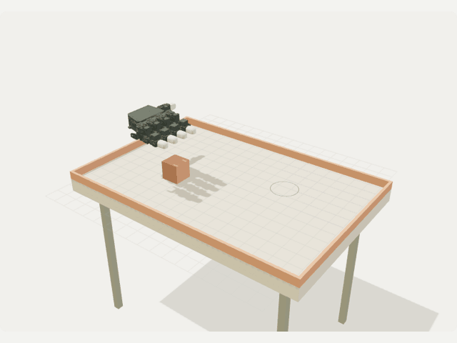
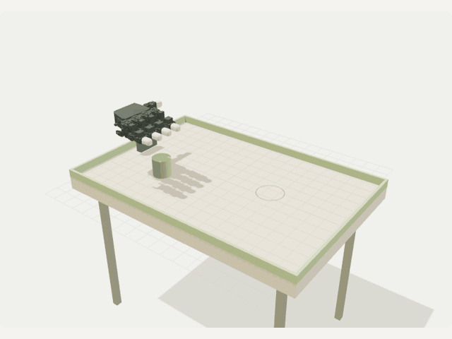
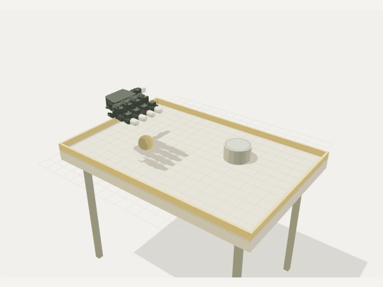
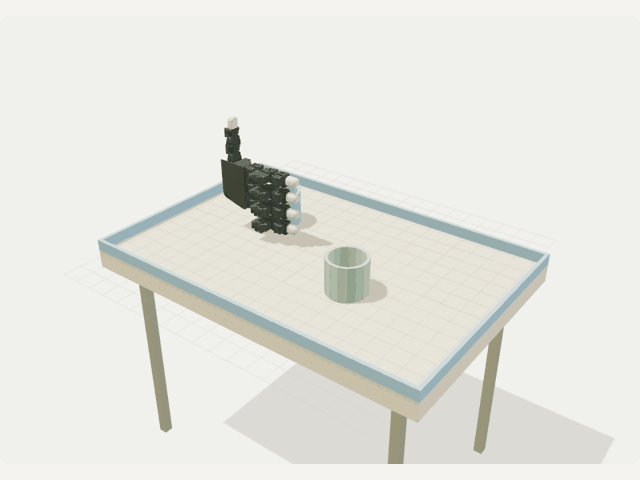

---
language:
- en
license: cc-by-4.0
task_categories:
- robotics
tags:
- mujoco
- robotic-hand
- assisted-manipulation
- synthetic
- muse-wonder
- subq
pretty_name: Labbit robotic manipulation studies
configs:
- config_name: tabletop_overview
  default: true
  data_files:
  - split: train
    path: tabletop/summary.jsonl
- config_name: tabletop_trajectories
  data_files:
  - split: train
    path: tabletop/episode-*.json.gz
- config_name: muse_scenarios
  data_files:
  - split: train
    path: muse/scenarios.json
- config_name: native_hand_20s
  data_files:
  - split: train
    path: hand-native/objectives100-20s/*.parquet
- config_name: native_hand_5s
  data_files:
  - split: train
    path: hand-native/objectives100/*.parquet
- config_name: native_hand_legacy90
  data_files:
  - split: train
    path: hand-native/pilot90/*.parquet
- config_name: browser_hand_20s
  data_files:
  - split: train
    path: hand-browser/shard-*.json.gz
- config_name: subq_reviews
  data_files:
  - split: train
    path: subq/*.json
---

# Labbit: trajectories, Muse proposals, and SubQ visual reviews

Live explorer: https://hand-studio.hidden-pond-5e6a.workers.dev

Source: https://github.com/nayeonshin/aie-code-summit-2026-hackathon

## See the trajectories

| Pick & place · episode 1 | Contact push · episode 2 |
| --- | --- |
|  |  |
| Stack · episode 4 | Particle pour · episode 3 |
|  |  |

These are renders of **actual published recordings**, not AI-generated videos. GIFs sample the 30 Hz data at 10 Hz and use display color quantization; the dataset itself preserves all 361 recorded frames and numeric values. `media/previews.json` links each visual to its exact dataset revision, trajectory SHA-256 and sampled frame indices.

The push shown above ends **24.7 cm from its target** and is retained as a failure example. The pouring example records **36/36 rigid particles** in the receiver; this is not a water-volume measurement. Pick/place, stacking and cup transport are assisted by a scripted wrist and compliant weld.

## Objective

Build an inspectable, reproducible collection of tabletop manipulation attempts, where **scenario inputs, recorded motion, numerical outcomes and AI provenance remain separate**. Bounded variations cover object shape/size/mass, table friction, placement and task-dependent motion. Success is not presumed from a valid simulation or a model-generated proposal.

The dataset is an engineering/research pilot, not a claim of autonomous robot manipulation. It supports auditing and improving a data pipeline before larger-scale generation.

## Why this simulation data is useful

- **Temporal motion research:** use known object/hand geometry transforms for motion prediction, trajectory retrieval, temporal representations and scene tracking.
- **Synthetic visual experiments:** render the same trajectory reproducibly to study viewpoints, occlusion and visual features, with known simulator-derived geometry. Raw per-frame images are not included; the GIFs are documentation examples.
- **Simulator and dataset debugging:** inspect grasp orientation, contact counts, released-object motion, parameter coverage and failed attempts without rerunning physics.
- **Infrastructure evaluation:** exercise compact storage, checksums, exact replay, provenance linkage and parallel processing using shareable public artifacts.

**Not suitable as-is for low-level behavior cloning:** tabletop exports do not include per-frame actuator commands, joint positions/velocities or force/wrench telemetry. Contact counts are not contact forces. Additional action-complete exports and a validated robot/control model would be needed for that use. No sim-to-real transfer, physical safety, or autonomous grasp-success claim is made.

The Dataset Viewer’s `train` split is a file-loading convention, **not a curated training/evaluation split**. Seeded scenarios share proposal anchors and geometry; build held-out scenario-family/anchor splits rather than blindly mixing near-related examples across train and test.

## Separate data roles

- **MuJoCo produces the physics trajectories**: geometry transforms, object motion, contacts, and measured numerical outcomes.
- **Muse Wonder proposes physical parameters and diversity rationale**: task, shape, size, mass, friction, start/goal positions, speed, lift height and curved transport paths. Its proposals are not successful trajectories or labels.
- **SubQ Snap reviews images**: advisory movement and coordination classifications, stored separately with input hashes. The existing saved reviews are hand-only samples; their source-run association was not recorded. They are **not falsely attached to tabletop episodes**.

## Files and counts

`catalog.json` is the authoritative published inventory. `tabletop/index.json` lists completed tabletop episodes and measurements. `muse/scenarios.json` lists **1,000 planned scenarios** derived from real Muse anchors with deterministic seeded jitter. **100 tabletop trajectories** have been computed and exported; do not confuse planned and recorded counts. The raw plan records the exact accepted anchor count.

| Inventory | Count | Meaning |
| --- | ---: | --- |
| Tabletop trajectories | 100 | Completed 12-second, five-finger manipulation recordings |
| Muse-derived scenarios | 1,000 | Planned inputs, not 1,000 recorded episodes |
| Muse proposal anchors | 24 | Accepted bounded tabletop parameter proposals |
| Archived hand-only episodes | 390 | Separate native/browser four-finger collections |
| Saved SubQ reviews | 2 | Hand-only samples; no tabletop visual reviews yet |

Compact tabletop replay occupies **132.7 MB versus 1,077.1 MB** for standalone copies (~88% smaller), with 10 shared meshes. Both encodings represent the same 100 trajectories. Original standalone files remain available, so total repository storage has not decreased in this additive compatibility release.

### What one tabletop episode contains

- `scenario`: task, seed, supported physical/motion parameters and Muse proposal attribution when used.
- `geoms`: renderable primitive geometry and licensed hand meshes; compact copies reference shared meshes by hash.
- `frames`: time, per-geometry position/rotation, contact count, object/object-center and palm/grasp positions, palm normal and assisted-holding state.
- `metrics`: numerical finiteness, peak contact count, final target distance, and particle retention for pours.
- `provenance`: actual simulator runtime, controller, timestep, hand model/actuator count and fluid approximation.

Positions/distances are **meters**, masses **kilograms**, time **seconds**, rotations flattened **3×3 matrices**, and contact values integer counts. Each tabletop episode has **361 frames over 12 seconds at 30 Hz**, with a **0.004-second physics timestep**. These are rendered geometry trajectories, not a full serialized MuJoCo state.

Use the Hugging Face Dataset Viewer's **configuration selector** to switch between the compact tabletop overview, full trajectories, Muse scenarios, separate native/browser pilots, and SubQ reviews. The default overview contains one row per completed tabletop study with physical parameters, Muse attribution and measured outcomes. `subq_reviewed=false` means no tabletop visual review exists; it is not an inferred classification.

- `tabletop/episode-*.json.gz`: 12-second tabletop episodes, 361 frames at 30 Hz including the initial state, plus geometry, parameters and provenance.
- `tabletop/compact/index.json`: compact replay inventory, exact scenario identities, trajectory/shared-mesh checksums and file sizes.
- `tabletop/compact/episode-*.json.gz`: the **same recorded episodes**, with shared mesh references replacing embedded meshes. All 361 frames, transforms, contact/grip telemetry, metrics and provenance are preserved without numeric quantization.
- `tabletop/meshes/<sha256>.json.gz`: immutable geometry shared across episodes, addressed by the SHA-256 of its compressed bytes. Compact copies do **not** add new trajectories to the recorded count.
- `muse/tabletop-plan.json`: raw structured Muse plan, model, plan ID, time and usage; `muse/scenarios.json`: applied scenario parameters.
- `hand-browser/`: 100 archived 20-second hand-only production episodes and their immutable manifest/checksums. These use a four-finger LEAP model and 28 Muse parameter anchors.
- `hand-native/`: 290 archived hand-only native episodes across three pilots. Native/browser controllers and MuJoCo versions differ; do not pool them without checking provenance.
- `subq/`: separately saved advisory visual reviews; no fabricated tabletop reviews.
- SO-101 arm studies (`task: so101`, when packaged): seeded, not Muse-proposed. 16.9-second episodes, 508 frames at 30 Hz, listed in `tabletop/index.json` after the hand plan's IDs and planned in `tabletop/arm-scenarios.json`. `catalog.json` counts them separately (`arm_planned`, `arm_recorded`) under their own collection; in `tabletop/summary.jsonl`, `robot` is `so101-arm` and the `muse_*` fields are empty.

## Grip correction and validation

The tabletop wrist is oriented with the palmar side facing the object. Fingertip targets are calibrated using MuJoCo articulated kinematics. The object-local wrist offset rotates consistently during pouring; cups are held from the side rather than with the back of the hand. Exports include palm position, palmar normal, grasp center and holding state for checking alignment.

## Important limitations

This dataset is **assisted manipulation, not an autonomous grasping benchmark**. A mocap wrist and temporary weld constraint transport grasped objects; hand collisions are disabled. Released bodies and contact-driven pushes use actual MuJoCo rigid-body dynamics. No learned manipulation policy is claimed.

Scenario fields preserve the Muse proposal inputs; **not every field applies to every task**. Pouring uses fixed source-cup geometry (49 mm wall-center radius, 115 g cup mass) and 180 mm lift clearance; its proposed solid `shape`, `size`, `mass`, `lift` and `lateral` do not override that calibrated cup. Pouring still varies source/receiver placement, speed and table friction. Pushing uses a straight contact sweep, so proposed lift/transport curvature do not apply. The overview separates actual object mass/solid extent from `muse_proposed_*` fields; do not treat ignored proposals as physical measurements.

The five-finger / 20-actuator tabletop hand is a custom geometry extension of the licensed four-finger LEAP model, not a calibrated five-finger robot. Pouring uses **36 discrete rigid particles**, not a continuum fluid solver, water volume measurement, or real-world pouring guarantee. Source/receiver cup geometry and pouring clearance remain calibrated rather than AI-generated.

SubQ reviews and tracking scores are advisory/proxy measurements, not safety or grasp-success ground truth. Inspect failures, model/controller revisions, durations and units before using the data for training or evaluation.

## Read a tabletop episode

The app prefers a published compact recording only when its full scenario matches the active scenario. It checks checksums, geometry and telemetry before replay. Different/new scenarios are computed on demand; a corrupt matching recording produces a visible error, not a silently recomputed substitute. The frontend inventory is pinned to an immutable Hugging Face commit so concurrent publication cannot mix trajectory and geometry versions.

Shared geometry is restored by loading the compact episode and replacing each `geom.mesh` SHA-256 reference with the JSON object from the matching mesh file. The restored episode equals its original standalone episode; the standalone files remain available for compatibility. `python -m scripts.compact_tabletop --workers=4` verifies every lossless round trip before committing the compact inventory.

```python
import gzip
import json
from huggingface_hub import hf_hub_download

path = hf_hub_download('MedSalim/labbit-robotic-manipulation', 'tabletop/episode-0001.json.gz', repo_type='dataset')
with gzip.open(path, 'rt', encoding='utf-8') as file:
    episode = json.load(file)
print(episode['scenario']['proposal'])  # Muse input attribution
print(episode['provenance'])            # actual physics/controller
print(episode['metrics'])               # measured simulation output
```

## Privacy and license

Exports include only allowlisted trajectories, structured model proposals, saved review outputs and public manifests. Credentials, admin tokens, `.env` files, worker logs and private configuration are excluded. The original hand geometry license (LEAP) is retained in `ROBOT_MODEL_LICENSE`. When SO-101 arm episodes are included, their mesh geometry comes from TheRobotStudio's SO-ARM100 model under Apache-2.0: see `SO101_MODEL_LICENSE` and the pinned revision in `SO101_MODEL_SOURCE.json`. Refer to these for geometry reuse. Dataset documentation and newly generated trajectory exports are CC BY 4.0.
